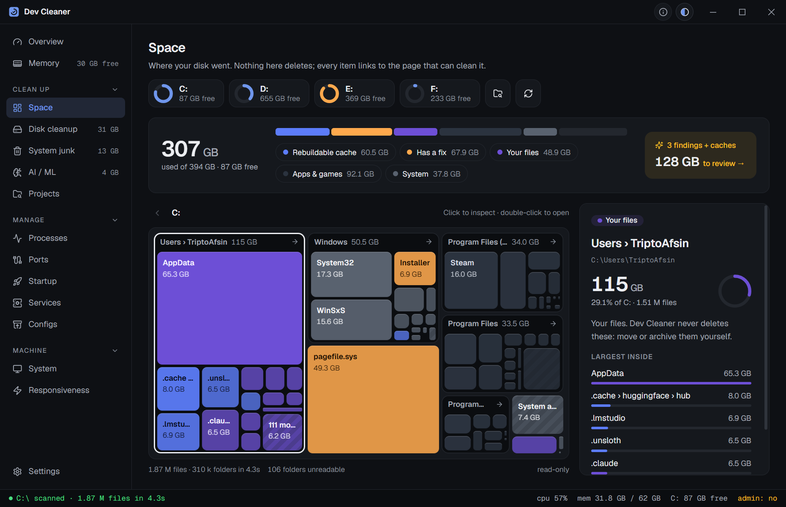
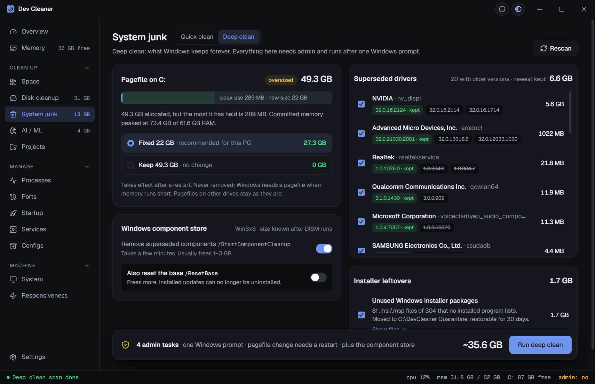
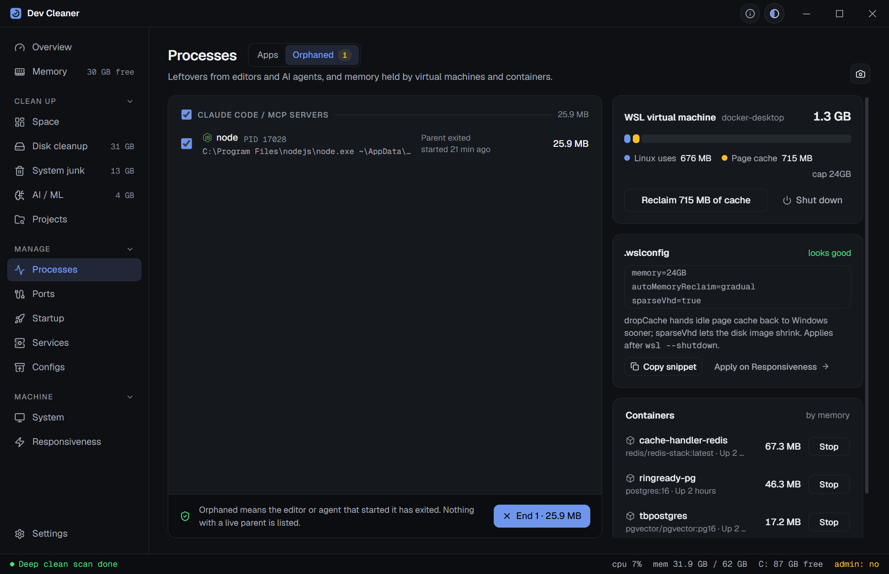
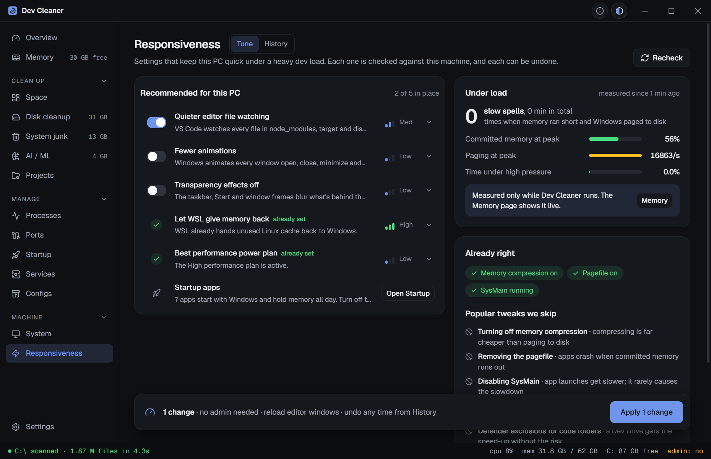

<div align="center">


# Dev Cleaner

**Reclaim disk and memory from developer caches, build folders, AI models, processes and ports, and see where your disk went.**

Windows, macOS and Linux · Rust core, React shell, built with Tauri 2 · MIT

[Download](https://github.com/TriptoAfsin/dev-cleaner/releases/latest) · [Install with a package manager](#install) · [Changelog](./CHANGELOG.md)

<a href="https://apps.microsoft.com/detail/9N1VVF6949HW"></a>


</div>

## What it does

Dev machines fill up with things that can be rebuilt: package caches, `node_modules`, Rust `target` folders, Docker layers, Hugging Face downloads, compile caches. Dev Cleaner finds them, tells you what each one is and what deleting it costs, and cleans with the tool's own command where there is one (`npm cache clean --force`, `pnpm store prune`, `go clean -cache`...), falling back to deleting the folder.

Nothing is removed until you confirm. Anything the OS needs is protected.

| | |
|---|---|
| **Space**: a map of where a drive's space went. A whole-drive scan (C: with 1.9 M files takes a few seconds) is drawn as nested tiles coloured by what each folder is: rebuildable cache, has a fix, your files, apps or the OS. Click to inspect, double-click to open; each item says what it is, its largest contents and which page cleans it. Findings like an oversized pagefile, old drivers or Phone Link photo syncs are listed with what they would free. Read-only. |  |
| **Disk cleanup**: 110+ caches across Node and its version managers, Bun, Deno, Rust, Python, Go, Java, Kotlin, Android, Scala, Clojure, Groovy, .NET, Ruby, PHP, Swift, Dart, Haskell, Elixir, Erlang, Julia, R, Perl, OCaml, Nim, Crystal, D, Gleam, Elm, Lua, Zig, C/C++, Terraform, Pulumi, Bazel, Docker, Kubernetes, Android Studio and the SDK, React Native, embedded toolchains, game engines, editors and remote editor servers, and the OS. pnpm stores are found on every drive, and each tool is asked where its cache really is. |  |
| **System junk**: temp folders, Windows Update and Delivery Optimization leftovers, error reports, memory dumps, servicing logs, thumbnail caches, browser and chat-app caches, unfinished downloads and the Recycle Bin / Trash. macOS: app caches, logs, Xcode device support, simulators, Mail attachments, Time Machine snapshots. Linux: thumbnails, journal, apt/dnf/pacman caches, old Snap revisions, unused Flatpak runtimes. Items that need admin run together after one approval. *Deep clean* (Windows): superseded driver packages (the newest is always kept, in-use drivers refuse removal), unused Windows Installer files (quarantined, restorable), a pagefile size advisor and the component store cleanup. |  |
| **Projects**: point it at your code folders or whole drives; it finds `node_modules`, Python venvs, Rust, Maven and sbt `target`, Gradle `build`, .NET `bin`/`obj`, Composer `vendor`, Swift `.build`, Flutter, Mix, Stack, Cabal, Zig and CMake build trees, `.next`, `.turbo`, `.svelte-kit`, Android native `.cxx`, Unity `Library`, Godot and Unreal caches, shows when each was last used, and deletes the ones you pick. Source is never touched. |  |
| **AI / ML**: *Models*: Ollama, LM Studio and Hugging Face models, plus loose `.gguf`, `.safetensors`, `.ckpt`, `.pt` and `.onnx` files (ComfyUI, Automatic1111, downloads); nothing is pre-selected and Ollama models are removed with `ollama rm`. *Harnesses*: what AI coding agents leave behind (Claude Code temp folders, MCP logs and old versions, Codex logs and old releases, Kimi Code, OpenCode, Qwen Code, Copilot CLI, agent-browser, T3 Code, Ghostex and more), never their transcripts, memory or settings. *CLI tools*: Hugging Face, PyTorch, Keras, wandb and Gradio caches. |  |
| **Processes and memory**: apps grouped by name, sorted by RAM or CPU, each with a verdict: *Safe to end*, *Save first* or *System*. A live Top CPU chart with End buttons. *Memory pressure* (Low, Moderate, High) from committed memory, free RAM and paging, with history and the apps whose memory keeps growing. *Orphaned*: MCP servers, language servers and dev servers left running after their editor or agent closed, the WSL VM's page cache (reclaim it in one click) and Docker containers. Free memory trims idle pages without closing anything. |  |
| **Ports**: which process holds 3000, 5173, 5432, 8080 and other dev ports, with the command line and project folder; free a port in one click. |  |
| **Responsiveness**: reversible settings that keep a PC quick under a heavy dev load: WSL hands back memory it no longer uses, quieter VS Code / Cursor / Windsurf file watching, the High performance power plan, fewer animations, no transparency. Each shows the evidence from this machine and the exact change, and can be undone from History. Popular tweaks that don't help (turning off memory compression or the pagefile, RAM boosters, registry speed hacks) are listed with why they are skipped. |  |
| **System**: OS, CPU, memory compression, page file, drives, battery (laptops only), WSL, runtimes, editors and AI coding CLIs, each value with a tooltip, plus recommendations on where performance goes. Copy it all as Markdown for a bug report. |  |
| **Configs**: back up VS Code, Cursor, Zed, JetBrains, Claude Code, Codex, Gemini, Copilot and more to one zip with instructions an AI agent can follow to restore it. Restore backs up what it replaces first. Copy settings, extensions, skills, commands, rules and MCP servers between tools. |  |

Also: choose which drives to include (pnpm stores, Recycle Bins, project and model scans), save or copy any page as a PNG, a shareable card after each clean, light/dark/system themes with an accent picker, and a custom title bar that still drags, snaps, maximizes on double-click and remembers its position, size and monitor.

<p align="center">
  
  
</p>

## Install

**Windows:** the easiest way is the [Microsoft Store](https://apps.microsoft.com/detail/9N1VVF6949HW). The Store build is signed, so SmartScreen doesn't warn, and the Store keeps it up to date.

<a href="https://apps.microsoft.com/detail/9N1VVF6949HW"></a>

For every other system, or to install without the Store, download the installer from [Releases](https://github.com/TriptoAfsin/dev-cleaner/releases/latest):

- **Windows**: `.msi` or `-setup.exe`, or the portable `.zip` (settings stay in a `data` folder beside the exe).
- **macOS**: `.dmg`, Apple silicon (`aarch64`) or Intel (`x64`).
- **Linux**: `.AppImage` (any distro), `.deb` (Debian, Ubuntu), `.rpm` (Fedora, openSUSE) or `.flatpak` (`flatpak install --user Dev.Cleaner_*_x86_64.flatpak`). The Flatpak needs wide permissions to be useful (host files, and running `ps`, `ss`, `kill` and package tools on the host through `flatpak-spawn`); the AppImage, deb and rpm run without a sandbox.

Or with a package manager:

```sh
# macOS, Homebrew
brew install --cask t21dev/tap/dev-cleaner

# Windows, Scoop
scoop bucket add t21dev https://github.com/t21dev/scoop-bucket
scoop install t21dev/dev-cleaner

# Windows, WinGet (installs the Microsoft Store build)
winget install 9N1VVF6949HW -s msstore

# Windows, WinGet (GitHub build, once the first submission is merged)
winget install TriptoAfsin.DevCleaner
```

> The GitHub builds are not code-signed yet. On Windows, SmartScreen shows "Windows protected your PC": click **More info → Run anyway**. On macOS run `xattr -cr "/Applications/Dev Cleaner.app"` (the Homebrew cask does this for you). Every release lists SHA-256 checksums.

## Safety

- Read-only until you confirm. Scans never change anything.
- The tool's own clean command runs first; folder contents are deleted only as a fallback, and files in use are skipped.
- Temp folders: only items older than a day; system temp, error reports and logs only past 7 or 30 days.
- Things that are never cleaned because it does harm: Windows Prefetch, WinSxS by hand, pagefile/hiberfil, macOS language files and app thinning (they break code signatures), the macOS sleep image, and anything in a browser profile except its caches (cookies, history and passwords are never touched).
- Admin items (Windows temp, update cache, servicing logs, DISM; macOS system logs and snapshots; Linux journal and package caches) are never pre-selected and run in one elevated batch after a single UAC or password prompt.
- Recycle Bin / Trash, device backups, Xcode archives and Windows.old count as your data: never pre-selected, and the confirmation says it can't be undone.
- Processes the OS needs (csrss, svchost, lsass, WindowServer, launchd...) cannot be ended, from the UI or the backend.
- Project and model deletes are re-validated in the backend: only a recognised build folder or model file can be removed.
- Downloaded AI models, experiment outputs (`wandb/`, `mlruns/`, `outputs/`) and the Hugging Face `token` are never selected for you.
- Nothing about you or your files leaves your machine. The only network requests are the update check (GitHub's releases API) and the definitions download (the `definitions/` files from this repository on GitHub), plain requests with nothing about you in them. Both can be turned off in Settings; Refresh on the Definitions card still fetches on demand.

## Terms of use and disclaimer

By installing or using Dev Cleaner you accept the [MIT License](LICENSE) it is distributed under, including these terms:

- **No warranty.** Dev Cleaner is provided "as is", without warranty of any kind, express or implied.
- **You decide what is deleted.** The app only deletes what you select and confirm. Deletes are permanent: they don't go to the Recycle Bin or Trash and can't be undone.
- **No liability.** The authors and contributors are not liable for any loss of data, lost work, damage to your system or software, downtime, or any other loss or damage arising from using, or being unable to use, this software, however caused.
- **Back up first.** Keep backups of anything you can't afford to lose, and read what each item does (every row explains it) before cleaning. Ending processes and changing services or startup programs is also at your own risk.

If you don't accept these terms, don't install or use the software.

## Privacy

Dev Cleaner collects nothing: no accounts, telemetry or analytics. Its only network requests are update and definitions checks to GitHub. See the [privacy policy](PRIVACY.md).

## Definitions

What the app knows (cache locations, project build folders, process verdicts, port hints, AI model folders, config files) lives as data in [`definitions/`](definitions/README.md), not in code. A copy is built into the app, and new rules reach you without an app update: Settings → Definitions → **Refresh** downloads the newest set from this repository (the app also checks daily when update checks are on), checks it, and uses it when it is newer. A rule written for a newer version of the app is skipped on older ones, and the rest of the set still applies. Adding a cache is a JSON edit; see the [definitions guide](definitions/README.md).

## Develop

Requirements: Node 22+, Rust stable, and the [Tauri prerequisites](https://tauri.app/start/prerequisites/).

```sh
npm install
npm run app          # dev build with hot reload
npm run app:build    # installers in src-tauri/target/release/bundle
```

### Tests

```sh
cd src-tauri && cargo test     # unit tests
npm run e2e:build && npm run e2e   # end-to-end, Windows
```

The end-to-end suite drives the real release binary through WebDriver (`tauri-driver` + `msedgedriver`, fetched to match the installed WebView2). It runs under its own app identifier and points every cache path into a throwaway folder (`DEV_CLEANER_FAKE_HOME`), so it never touches real caches, settings or window state. It covers navigation, keyboard shortcuts, theme and accent persistence, cleaning, project and model deletes, freeing a real port, ending a real process, tooltips, snapshots, and window position/size/maximize restore including a monitor that has gone away.

`node e2e/screenshots.mjs [projectsFolder]` regenerates the screenshots above from the real app.

### Releasing

Versions follow [semantic versioning](https://semver.org/).

```sh
npm run version:patch -- --tag   # 0.1.0 -> 0.1.1, commit and tag
npm run version:minor -- --tag   # new features
git push && git push --tags
```

Pushing a `vX.Y.Z` tag runs `.github/workflows/release.yml`: Windows (msi, setup exe, portable zip), macOS (arm64, x64) and Linux (AppImage, deb, rpm) builds, a draft release with notes from `CHANGELOG.md`, and `SHA256SUMS.txt`. Homebrew and Scoop pick up new releases automatically; WinGet gets a PR from `.github/workflows/winget.yml` (see `packaging/winget/README.md`).

## License

MIT © Tripto Afsin. See [LICENSE](LICENSE) and the [terms of use](#terms-of-use-and-disclaimer) above.
