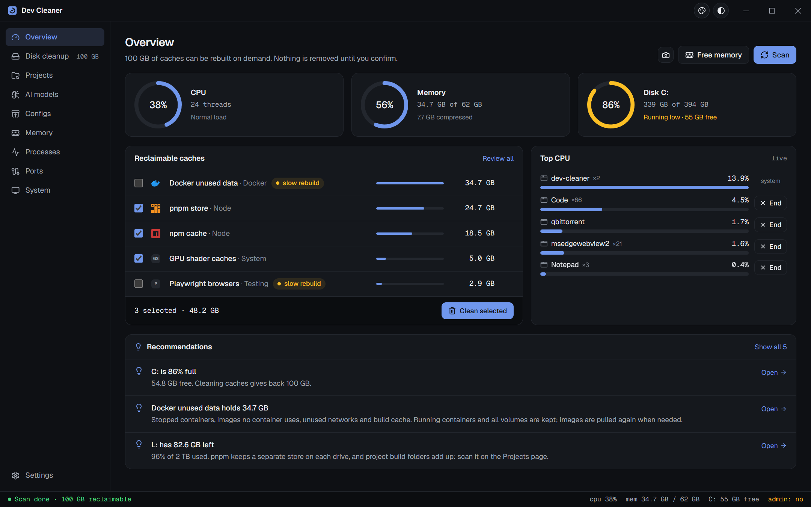
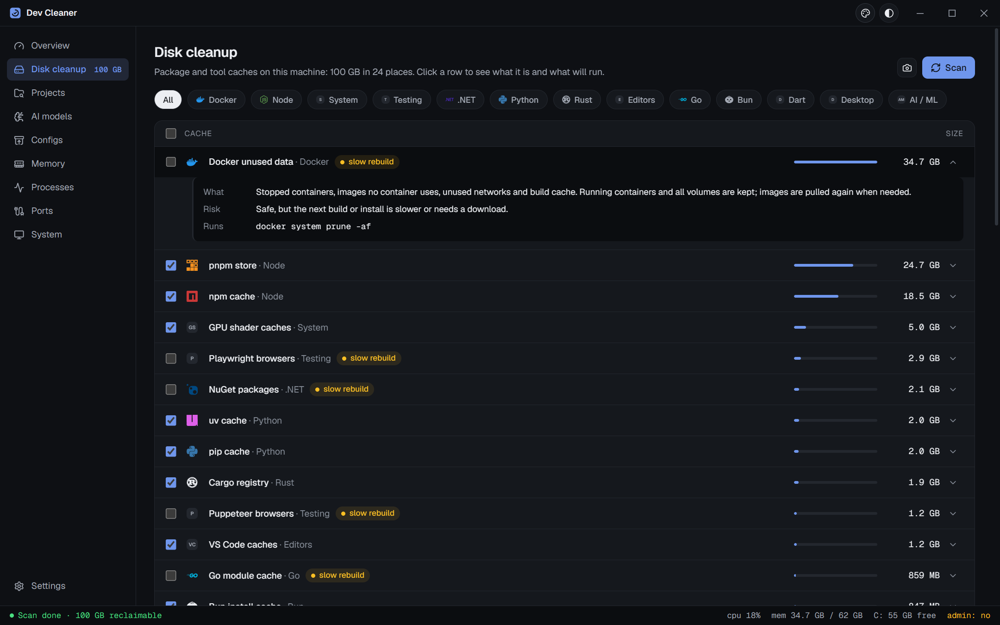
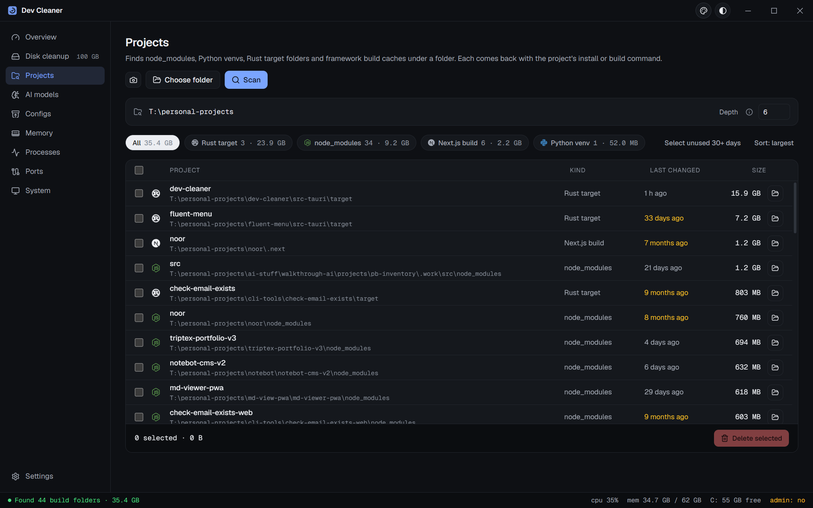
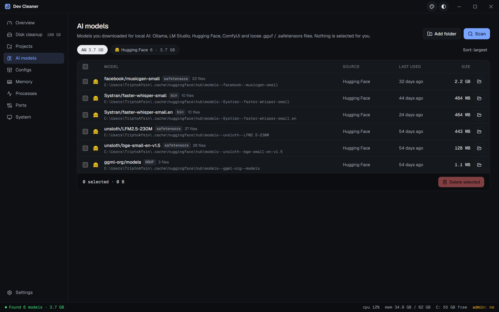
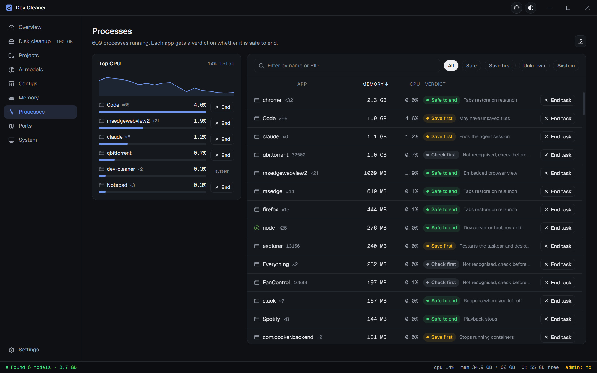
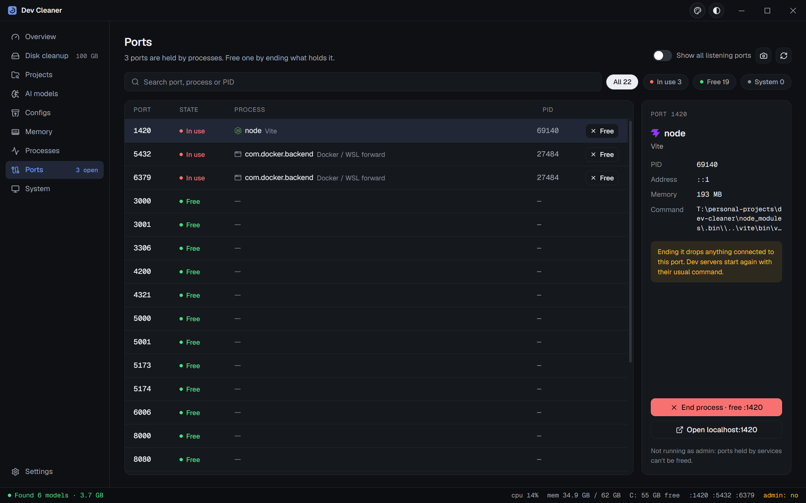
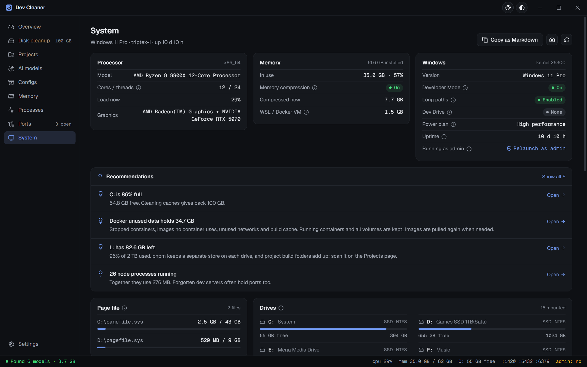
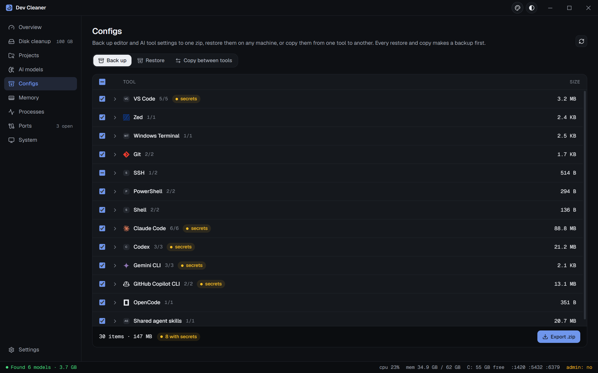
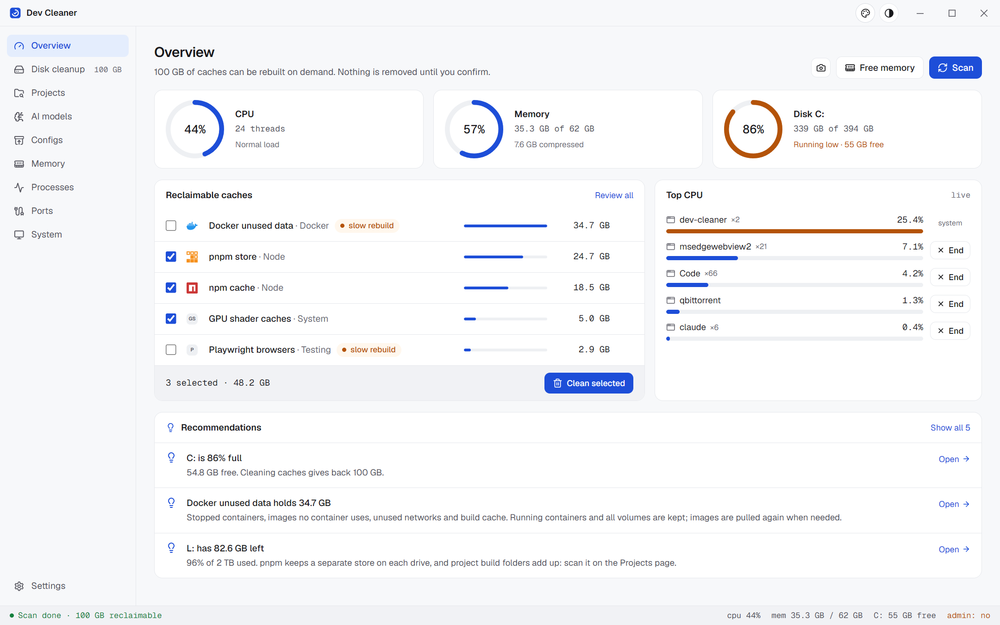
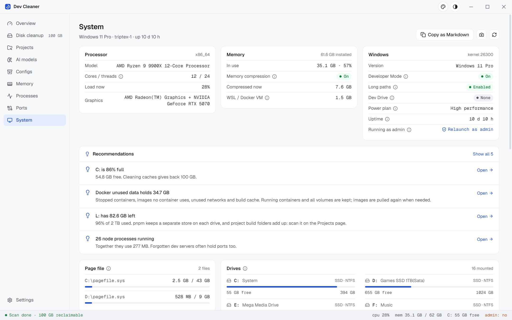

<div align="center">


# Dev Cleaner

**Reclaim disk and memory from developer caches, build folders, AI models, processes and ports.**

Windows and macOS · Rust core, React shell, built with Tauri 2 · MIT

[Download](https://github.com/TriptoAfsin/dev-cleaner/releases/latest) · [Install with a package manager](#install) · [Changelog](./CHANGELOG.md)



</div>

## What it does

Dev machines fill up with things that can be rebuilt: package caches, `node_modules`, Rust `target` folders, Docker layers, Hugging Face downloads, compile caches. Dev Cleaner finds them, tells you what each one is and what deleting it costs, and cleans with the tool's own command where there is one (`npm cache clean --force`, `pnpm store prune`, `go clean -cache`...), falling back to deleting the folder.

Nothing is removed until you confirm. Anything the OS needs is protected.

| | |
|---|---|
| **Disk cleanup**: 50+ caches across Node, Bun, Deno, Rust, Python, Go, Java, .NET, PHP, Dart, Scala, C/C++, Docker, editors, AI/ML and the OS. pnpm stores are found on every drive, and each tool is asked where its cache really is. |  |
| **Projects**: point it at your code folder; it finds `node_modules`, Python venvs, Rust `target`, `.next`, `.turbo`, `.svelte-kit`, Unsloth and Python tool caches, shows when each was last used, and deletes the ones you pick. Source is never touched. |  |
| **AI models**: Ollama, LM Studio and Hugging Face models, plus loose `.gguf`, `.safetensors`, `.ckpt`, `.pt` and `.onnx` files (ComfyUI, Automatic1111, downloads). Nothing is pre-selected; Ollama models are removed with `ollama rm`. |  |
| **Processes and memory**: apps grouped by name, sorted by RAM or CPU, each with a verdict: *Safe to end*, *Save first* or *System*. A live Top CPU chart with End buttons. Free memory trims idle pages without closing anything. |  |
| **Ports**: which process holds 3000, 5173, 5432, 8080 and other dev ports, with the command line and project folder; free a port in one click. |  |
| **System**: OS, CPU, memory compression, page file, drives, battery (laptops only), WSL, runtimes, editors and AI coding CLIs, each value with a tooltip, plus recommendations on where performance goes. Copy it all as Markdown for a bug report. |  |
| **Configs**: back up VS Code, Cursor, Zed, JetBrains, Claude Code, Codex, Gemini, Copilot and more to one zip with instructions an AI agent can follow to restore it. Restore backs up what it replaces first. Copy settings, extensions, skills, commands, rules and MCP servers between tools. |  |

Also: save or copy any page as a PNG, a shareable card after each clean, light/dark/system themes with an accent picker, and a custom title bar that still drags, snaps, maximizes on double-click and remembers its position, size and monitor.

<p align="center">
  
  
</p>

## Install

Download the installer from [Releases](https://github.com/TriptoAfsin/dev-cleaner/releases/latest):

- **Windows**: `.msi` or `-setup.exe`, or the portable `.zip` (settings stay in a `data` folder beside the exe).
- **macOS**: `.dmg`, Apple silicon (`aarch64`) or Intel (`x64`).

Or with a package manager:

```sh
# macOS, Homebrew
brew install --cask t21dev/tap/dev-cleaner

# Windows, Scoop
scoop bucket add t21dev https://github.com/t21dev/scoop-bucket
scoop install t21dev/dev-cleaner

# Windows, WinGet
winget install TriptoAfsin.DevCleaner
```

> The builds are not code-signed yet. On Windows, SmartScreen shows "Windows protected your PC": click **More info → Run anyway**. On macOS run `xattr -cr "/Applications/Dev Cleaner.app"` (the Homebrew cask does this for you). Every release lists SHA-256 checksums.

## Safety

- Read-only until you confirm. Scans never change anything.
- The tool's own clean command runs first; folder contents are deleted only as a fallback, and files in use are skipped.
- Temp folders: only items older than a day.
- Processes the OS needs (csrss, svchost, lsass, WindowServer, launchd...) cannot be ended, from the UI or the backend.
- Project and model deletes are re-validated in the backend: only a recognised build folder or model file can be removed.
- Downloaded AI models, experiment outputs (`wandb/`, `mlruns/`, `outputs/`) and the Hugging Face `token` are never selected for you.
- Nothing leaves your machine.

## Develop

Requirements: Node 22+, Rust stable, and the [Tauri prerequisites](https://tauri.app/start/prerequisites/).

```sh
npm install
npm run app          # dev build with hot reload
npm run app:build    # installers in src-tauri/target/release/bundle
```

### Tests

```sh
cd src-tauri && cargo test     # unit tests
npm run e2e:build && npm run e2e   # end-to-end, Windows
```

The end-to-end suite drives the real release binary through WebDriver (`tauri-driver` + `msedgedriver`, fetched to match the installed WebView2). It runs under its own app identifier and points every cache path into a throwaway folder (`DEV_CLEANER_FAKE_HOME`), so it never touches real caches, settings or window state. It covers navigation, keyboard shortcuts, theme and accent persistence, cleaning, project and model deletes, freeing a real port, ending a real process, tooltips, snapshots, and window position/size/maximize restore including a monitor that has gone away.

`node e2e/screenshots.mjs [projectsFolder]` regenerates the screenshots above from the real app.

### Releasing

Versions follow [semantic versioning](https://semver.org/).

```sh
npm run version:patch -- --tag   # 0.1.0 -> 0.1.1, commit and tag
npm run version:minor -- --tag   # new features
git push && git push --tags
```

Pushing a `vX.Y.Z` tag runs `.github/workflows/release.yml`: Windows (msi, setup exe, portable zip) and macOS (arm64, x64) builds, a draft release with notes from `CHANGELOG.md`, and `SHA256SUMS.txt`. Homebrew and Scoop pick up new releases automatically; WinGet gets a PR from `.github/workflows/winget.yml` (see `packaging/winget/README.md`).

## License

MIT © Tripto Afsin
